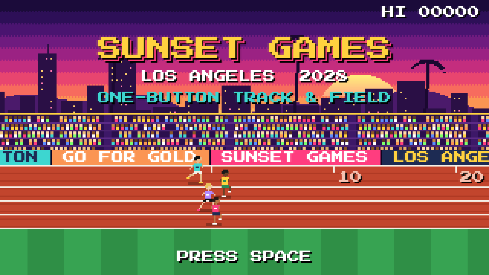

# hello-world-week-7
A one-button track and field meet

**Sunset Games '28** is a p5.js game for Logic of Interaction, week 7. The assignment was to
turn a classic arcade game into a one-button game by automating some of its controls.

## The game I started from

**Track & Field** (Konami, 1983). The arcade version used three buttons: two RUN buttons
that you pressed one after the other, and an ACTION button. I kept five of its six events
and restyled it as a sunset stadium in Los Angeles in 2028.

## What I automated

Everything now runs on the **space bar**, even the menu. Each event uses that one button differently.

| Event | What you do | What's automated |
|---|---|---|
| 100m Dash | Mash to run | Nothing |
| Long Jump | Mash to sprint, hold in the yellow zone, release when the angle meter is in the green | The take-off spot, as long as you start holding in the zone |
| Javelin | Tap to lock your power, tap again to throw at the swinging angle | The run-up |
| 110m Hurdles | Hold to run, release to jump | Nothing |
| Hammer Throw | Tap once when the hammer is in the yellow zone | The spinning, which gets faster every turn |

In the menu, **tap** moves to the next item and **hold** chooses it.

## How to play

1. Open [`one-button-track/index.html`](one-button-track/index.html) in a browser. It needs an internet connection to load p5.js and the pixel font.
2. Press space, then choose **THE GAMES** to play all 5 events or pick one event to practice.
3. You compete against three computer rivals. In field events everyone gets 3 attempts and their best one counts. Races are run once, and a false start uses up one of your 3 starts.
4. Your best mark in each event earns points, using decathlon-style scoring. No mark means 0 points, and the Games carry on.
5. After all 5 events, the final standings rank everyone by total points. **Finish in the top 3 to win a medal. Finish 4th and it's game over.**
6. Press space on the end screen to play again.

The [game's own README](one-button-track/README.md) has the full rules and the scoring formulas.

## How I made this

I built this with Claude (Claude Code). I chose the game, the events and the Los Angeles
theme, then played each version and decided what to change: the long jump controls and
runway, the false start rules, three attempts in field events, and decathlon scoring. Claude
wrote the code and handled the git setup, and used simulated players to tune the rivals'
difficulty.
